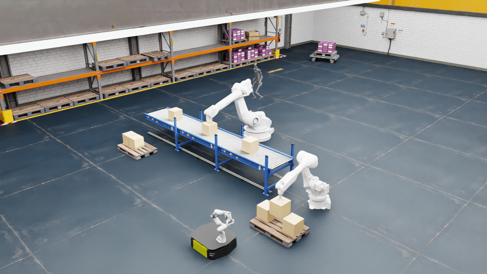

# Isaac Sim 공장 자동화 라인 모션 예시

Isaac Sim 6.2에서 산업용 로봇 2대, 휴머노이드 1대, AMMR 1대가 한 라인에서 움직이는 예시다. ROS 2는 쓰지 않는다.




## 구성

| 역할 | 로봇 | 동작 | 구동 방식 |
| --- | --- | --- | --- |
| 산업용 로봇 A | KUKA KR210 L150 | 컨베이어 위 박스를 벨트 속도로 따라가며 검사 | 미분 IK |
| 산업용 로봇 B | Kawasaki RS080N + RG2 | 벨트 끝에서 박스를 들어 팔레트 3칸에 차례로 적재 | 미분 IK |
| 휴머노이드 | Unitree H1 | 라인 옆 통로를 사각형으로 순찰 보행 | Isaac Sim 내장 보행 정책 |
| AMMR | Clearpath Ridgeback + Franka | 적재 팔레트와 출하 버퍼 사이를 왕복하고 팔을 뻗음 | 관절 키프레임 |

택트 타임은 8초다. 박스는 0.225 m/s로 흐르고 8초마다 1개씩 적재된다. AMMR 왕복 주기는 40초다.

## 실행

```bash
C:\isaacsim-6.2\python.bat factory_line_demo.py
```

창이 뜨고 바로 재생된다. 창을 닫으면 끝난다. 정지 후 다시 재생하면 처음부터 시작한다.

**첫 실행은 오래 걸린다.** 창고·로봇 에셋 약 1 GB를 인터넷에서 받는다. 이 PC에서 약 12분 걸렸다. 그 뒤로는 캐시를 써서 약 30초 만에 뜬다.

## 자체 점검

```bash
C:\isaacsim-6.2\python.bat factory_line_demo.py --headless --seconds 40
```

40초를 돌린 뒤 아래를 검사하고 `SELF-CHECK PASS` 또는 `FAIL`을 출력한다. 화면 캡처는 `out/`에 저장된다.

- 두 산업용 로봇의 손끝 평균 오차 0.03 m 미만, 공구가 아래를 향함
- AMMR 베이스가 경로를 0.3 m 이내로 따라감
- H1 골반 높이 0.8 m 초과(넘어지지 않음), 평균 0.25 m/s 넘게 보행

`--headless`를 빼면 같은 점검을 GUI 창에서 한다.

## 바꿔 보기

모두 `factory_line_demo.py` 위쪽 상수다.

- `TAKT`, `BELT_V` — 라인 속도. `X_OUT - X_IN = 3 * TAKT * BELT_V`를 유지해야 박스가 집히는 순간과 맞는다.
- `scan_target`, `palletize_target` — 두 산업용 로봇의 손끝 경로.
- `AMMR_KEYS` — AMMR 베이스 위치·방향과 팔 자세 키프레임.
- `H1_WAYPOINTS` — 휴머노이드 순찰 지점.

## 제한

- 박스는 물리가 없는 시각용 큐브다. 그리퍼가 박스를 실제로 쥐지 않고, 박스가 그리퍼 위치를 따라간다.
- 로봇끼리의 충돌 회피는 없다. 경로가 겹치지 않게 배치했을 뿐이다.
- 시뮬레이션은 실시간의 약 0.7배로 돈다 (RTX 3070 8 GB 기준).
- 인터넷이 없으면 에셋을 못 받아 실행되지 않는다.
