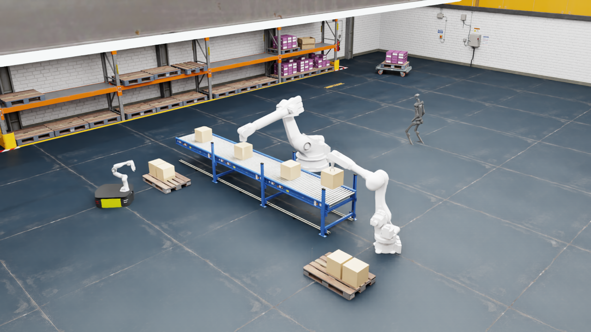

# Isaac Sim 공장 자동화 라인 모션 예시

Isaac Sim 6.2에서 산업용 로봇 2대, 휴머노이드 1대, AMMR 1대가 한 라인에서 움직이는 예시다.
로봇 동작은 ABB RAPID 스타일 프로그램으로 적고, 그 프로그램은 **ROS 2 노드**로 따로 돌아 topic·service로 로봇을 움직인다.




## 구성

네 로봇 모두 RAPID 스타일 프로그램으로 움직인다. 아래 "실제 구동"은 프로그램 명령을 관절에 전달하는 하위 방식이다.

| 역할 | 로봇 | 동작 | 실제 구동 |
| --- | --- | --- | --- |
| 산업용 로봇 A | KUKA KR210 L150 | 컨베이어 위 박스를 벨트 속도로 따라가며 검사 | `MoveL` → 미분 IK |
| 산업용 로봇 B | Kawasaki RS080N + RG2 | 벨트 끝에서 박스를 들어 팔레트 3칸에 차례로 적재 | `MoveL` → 미분 IK |
| 휴머노이드 | Unitree H1 | 라인 옆 통로를 사각형으로 순찰 보행 | `MoveBase` → `/h1/cmd_vel` → Isaac Sim 내장 보행 정책 |
| AMMR | Clearpath Ridgeback + Franka | 적재 팔레트와 출하 버퍼 사이를 왕복하고 팔을 뻗음 | `MoveBase`·`MoveAbsJ` → 차체·팔 관절 목표 |

택트 타임은 8초다. 박스는 0.225 m/s로 흐르고 8초마다 1개씩 적재된다.
AMMR은 목표 거리·속도와 실제 도착에 따라 왕복한다.

## 파일 구성

| 파일 | 내용 |
| --- | --- |
| `factory_line_demo.py` | Isaac Sim 노드 `/isaac_sim`. 장면 구성, 관절 구동·IK·보행 정책, 박스와 센서, 자체 점검 |
| `rapid_controller.py` | RAPID 컨트롤러 노드 `/rapid_controller`. 네 로봇의 RAPID 스타일 프로그램과 목표 좌표 |
| `line_common.py` | 두 노드가 같이 쓰는 라인 배치 숫자, tooldata, ROS 2 설정, 메시지 변환 |
| `rapid_style.py` | `robtarget`·`MoveL` 등 RAPID 스타일 데이터·명령과 실행기 `RapidTask`. numpy·scipy만 쓴다 |
| `tests/test_box_signals.py` | 박스 신호·파지·초기 배치 단위 테스트 |
| `tests/test_rapid_controller.py` | 컨트롤러 노드의 메시지 변환·재시작·지령 모양 단위 테스트 |
| `learn/` | 빈 Isaac Sim에서 이 데모까지 14단계로 따라 하는 HTML 학습서. `learn/index.html`을 브라우저로 연다 ([learn/README.md](learn/README.md)) |
| `WORK_PC_PROMPT.md` | 다른 PC에서 에이전트에게 이 방식으로 이어서 작업시키는 인계 프롬프트 |
| `docs/rapid-execution-plan.md` | RAPID 방식 적용 계획 기록 |
| `STATUS.md`, `checklist.md` | 지금 상태와 열린 할 일 |
| `decisions/`, `log/`, `archive/` | 유효한 결정, 세션 일지, 정리 전 원본 (`context-notes.md`가 안내) |

`docs/codex-warning-fix/`는 개발 환경(Codex 설정) 수정 기록이며 시뮬레이션과 관계없다.

## 요구 사항

- Windows, Isaac Sim 6.2 (`C:\isaacsim-6.2`에 설치한 기준). 다른 위치면 아래 명령의 경로를 바꾼다.
- NVIDIA RTX GPU (RTX 3070 8 GB에서 확인).
- 첫 실행 때 인터넷 연결 (에셋 다운로드).
- ROS 2는 따로 설치하지 않는다. Isaac Sim 안에 들어 있는 ROS 2 Jazzy 라이브러리(`exts/isaacsim.ros2.core/jazzy`)를 쓴다.

## 실행

```bash
C:\isaacsim-6.2\python.bat factory_line_demo.py
```

| 옵션 | 뜻 |
| --- | --- |
| `--headless` | 창 없이 실행 |
| `--seconds N` | 시뮬레이션 N초만 돌리고 자체 점검 후 종료. 0(기본)이면 창을 닫을 때까지 실행 |
| `--no-controller` | 컨트롤러 노드를 같이 띄우지 않는다. 다른 터미널에서 직접 띄울 때 쓴다 |

이 명령 하나가 Isaac Sim을 시작하고, `rapid_controller.py`를 자식 프로세스로 같이 띄운다. 프로세스 두 개가 ROS 2 노드 두 개다.
터미널에 `[MOTION] ros2 | /rapid_controller (RAPID programs) -> topics -> /isaac_sim (robot drives)`와 `[ROS2] started /rapid_controller`가 출력된다.
창이 뜨고 바로 재생된다. 창을 닫으면 컨트롤러도 같이 끝난다. 정지(■) 후 다시 재생하면 두 노드 모두 처음부터 시작한다.

**첫 실행은 오래 걸린다.** 창고·로봇 에셋 약 1 GB를 인터넷에서 받는다. 이 PC에서 약 12분 걸렸다. 그 뒤로는 캐시를 써서 약 30초 만에 뜬다.

### 두 노드를 터미널 두 개로 따로 띄우기

ROS 2에서 노드가 독립된 프로그램이라는 것을 직접 보려면 따로 띄운다. 순서는 상관없다. 서로를 찾을 때까지 기다린다.

```bash
C:\isaacsim-6.2\python.bat factory_line_demo.py --no-controller
```

```bash
C:\isaacsim-6.2\python.bat rapid_controller.py
```

컨트롤러만 Ctrl+C로 끄면 로봇은 마지막 지령 자세에서 멈춘다. 다시 띄우면 프로그램이 첫 줄부터 이어서 움직인다.
실제 공장에서 외부 PC의 프로그램을 재시작하는 것과 같다.

## ROS 2 구조

### ROS 2가 하는 일

ROS 2는 **로봇 프로그램들 사이의 통신 규약이자 라이브러리**다. 로봇을 직접 움직이는 컨트롤러도 아니고, 전체를 지휘하는 중앙 프로그램도 아니다.

- **중앙 중계 프로그램이 없다.** 노드가 켜지면 같은 네트워크에 "나는 `/joint_states`를 발행한다"고 알리고, 원하는 노드가 발행자와 직접 연결한다 (DDS). ROS 1의 `roscore`는 전화번호부 역할만 했고, ROS 2는 그것도 없앴다.
- **노드의 단위는 로봇이 아니라 기능이다.** 로봇 한 대에도 드라이버·센서·주행·작업 순서 노드가 여럿 돈다. topic 이름만 맞으면 서로를 몰라도 연결되므로 부품을 바꿔 끼우기 쉽다.
- **"라인 전체를 관장하는 프로그램"은 직접 만드는 노드 하나다.** ROS 2가 지휘 기능을 주는 것이 아니라, 지휘 프로그램이 다른 노드와 대화할 통로를 준다.
- **비유.** 공장 바닥에 깐 표준 필드버스 배선과 같다. 배선이 PLC를 대신하지 않는다.

| ROS 2 | RAPID·RobotStudio 감각 | 이 예시에서 |
| --- | --- | --- |
| Node | Task 하나 | `/isaac_sim`, `/rapid_controller` |
| Topic (계속 흐르는 값) | signal, EGM 피드백 스트림 | 로봇 실제 자세, 센서 DI, 매 스텝 지령 |
| Service (요청 하나, 응답 하나) | `SetDO`, `Reset` | `/kawasaki/set_do_grip` |
| Action (목표·진행·결과) | `MoveL` 실행 | 쓰지 않음. 아래 "방식 1과 방식 2" 참고 |

### 이 예시의 노드와 통신

```
 [rapid_controller.py]  /rapid_controller            [factory_line_demo.py]  /isaac_sim
  RAPID 프로그램 4개 + RapidTask                        Isaac Sim 물리 + 관절 구동 + IK + 보행 정책 + 박스·센서

        ◀── /clock (rosgraph_msgs/Clock) ─────────────────  매 물리 스텝 0.005 s
        ◀── /kuka/flange_pose, /kawasaki/flange_pose ─────  손끝 링크 실제 자세 (TransformStamped)
        ◀── /ammr/joint_states ───────────────────────────  베이스 가상 관절 3 + 팔 7축 (JointState)
        ◀── /h1/pose ─────────────────────────────────────  H1 골반 자세 (PoseStamped)
        ◀── /cell/di_box_at_pick, /cell/di_box_at_scan ───  디지털 입력 (Bool)

        ──▶ /kuka/tcp_command, /kawasaki/tcp_command ─────  지금 TCP가 있어야 할 자세. child_frame_id = tool 이름
        ──▶ /ammr/joint_command ──────────────────────────  베이스 3 + 팔 7축 목표 (JointState)
        ──▶ /h1/cmd_vel ──────────────────────────────────  걷기 속도 [전진, 횡, 회전] (TwistStamped)
        ──▶ /kawasaki/set_do_grip  (service) ─────────────  SetDO doGrip (std_srvs/SetBool)
```

한 물리 스텝(0.005 s)에서 일어나는 일.

1. `/isaac_sim`이 로봇 실제 상태와 센서 값을 발행하고 마지막에 `/clock`을 발행한다.
2. `/rapid_controller`가 `/clock`을 받으면 그 시간차만큼 네 프로그램을 진행한다 (`RapidTask.step()`). 결과 지령을 발행한다.
3. `/isaac_sim`이 도착한 지령을 꺼내 IK·관절 목표·보행 정책으로 로봇에 적용한다. 답이 아직 안 왔으면 직전 지령을 유지한다.
4. `fine`은 컨트롤러가 받은 **실제** 손끝 자세가 목표 5 mm 안에 들어와야 다음 줄로 넘어간다.

### 방식 1과 방식 2

산업용 로봇을 ROS 2에 붙이는 방식은 "누가 경로를 계산하느냐"로 나뉜다. 이 예시는 방식 1이다.

| | 방식 1. 스트리밍 (이 예시) | 방식 2. 상위 지시 |
| --- | --- | --- |
| 경로 계산 | ROS 2 쪽 노드 (`RapidTask`) | 로봇 컨트롤러 (RAPID·KRL 프로그램) |
| 보내는 것 | 매 주기 "지금 있어야 할 자세" | "pPick으로 가라", "3번 작업 시작" |
| 실제 로봇의 해당 기능 | ABB EGM, KUKA RSI, FANUC Stream Motion, UR RTDE | ABB RWS(REST)로 RAPID 변수 쓰기·실행 |
| 주의 | PC 쪽 주기를 놓치면 로봇이 멈춘다. 실시간성이 필요 | 컨트롤러의 검증된 경로·안전 기능을 그대로 쓴다. 현장에서 더 흔함 |

이 예시에서 `MoveL`이 ROS 2 Action이 아닌 이유가 이것이다. 방식 2로 바꾸면 `/isaac_sim`이 보간을 맡고, `MoveL`이 목표·진행률·결과가 있는 Action이 된다.

### 실제 산업용 로봇에 ROS 2를 붙인다면

ABB·KUKA·FANUC·Yaskawa·Kawasaki는 각자 컨트롤러와 언어가 있고, 대부분 ROS 2가 컨트롤러 안에서 돌지 않는다.
그래서 보통 **ROS 2가 깔린 별도 PC**(브리지 PC)에 **로봇 회사별 드라이버 노드**를 띄운다.

```
[ROS 2 PC]  작업·경로 노드 ──▶ 드라이버 노드 (ros2_control 하드웨어 플러그인)
                                   │ 회사 전용 프로토콜 (EGM·RSI·RTDE 등, UDP/TCP)
[로봇 컨트롤러]  IRC5·OmniCore / KRC / R-30iB … ──▶ 로봇 팔
```

- 드라이버가 `/joint_states`를 발행하고 궤적 명령을 받는다. 위쪽 노드는 어느 회사 로봇인지 몰라도 된다.
- 이 예시의 `/isaac_sim`이 그 드라이버+로봇 자리에 있다. 같은 topic을 내보내는 실제 드라이버로 바꾸면 컨트롤러 노드는 그대로 쓸 수 있다는 것이 구조상의 의미다 (실제 로봇으로 시험하지는 않았다).
- 비상정지·안전 영역은 **항상 로봇 컨트롤러에 남긴다.** ROS 2 자체는 안전 인증을 받은 소프트웨어가 아니다.
- 회사별 현황은 기억에 의존한 내용이라 확인이 필요하다. UR은 공식 `ur_robot_driver`가 가장 성숙하다. Yaskawa MotoROS2는 예외적으로 컨트롤러 안(micro-ROS)에서 돈다. ABB는 커뮤니티 `abb_ros2`(EGM+RWS)가 있다. FANUC·Kawasaki의 ROS 2 지원 상태는 쓰기 전에 공식 자료로 확인한다.

### 통신 구현(RMW)과 topic 들여다보기

두 노드는 `rmw_fastrtps_cpp`(FastDDS)로 통신한다. Isaac Sim의 `python.bat`은 기본값을 `rmw_zenoh_cpp`로 정하는데,
Zenoh는 라우터(`rmw_zenohd`)를 따로 켜야 프로세스끼리 서로를 찾는다. 그래서 이 예시는 라우터가 필요 없는 FastDDS로 고정했다 (`line_common.py`의 `RMW`).

실행 중에 topic을 보려면 같은 RMW를 쓰는 ROS 2 환경에서 아래를 실행한다. Pixi로 만든 ROS 2 Jazzy 환경이라면 그 셸에서 RMW만 바꾼다.

```powershell
$env:RMW_IMPLEMENTATION="rmw_fastrtps_cpp"; ros2 topic list
```

```bash
ros2 topic echo /cell/di_box_at_pick
```

```bash
ros2 topic hz /clock
```

이 PC의 Pixi 환경에서 위 명령을 실제로 돌려 보지는 않았다. 노드끼리의 송수신은 아래 자체 점검으로 확인했다.

## RAPID 스타일로 동작 작성

네 로봇은 RAPID 스타일 프로그램으로만 움직인다. 목표 좌표·속도·zone·tool과 명령 순서를 적는다. 프로그램과 목표는 `rapid_controller.py`에 있다.

```python
yield MoveL(pPick, v1000, fine, tGripper)  # 집는 점까지 이동한 뒤 실제 TCP 도착을 기다린다.
yield WaitUntil(box_at_pick)  # 박스 도착 신호(/cell/di_box_at_pick)를 기다린다.
yield SetDO("doGrip", 1)  # /kawasaki/set_do_grip service로 박스를 TCP에 붙인다.
```

RAPID 방식은 ABB와 단위가 다르다. 길이는 m, 속도는 m/s다. `v1000`은 1.0 m/s, `z50`은 0.05 m다.
방향은 오일러 각 (rx, ry, rz) [deg]로 적고 `rx = 180`이 공구가 바닥을 보는 자세다 (ABB 쿼터니언 [0, 1, 0, 0]).
`MoveJ`, `wobj`는 없다. zone은 포물선으로 깎지 않고 반경 안에 들어오면 다음 목표로 방향을 튼다.

`rapid_style.py`는 Isaac Sim 없이 따로 시험할 수 있다.

```bash
C:\isaacsim-6.2\python.bat rapid_style.py
```

이것은 **RAPID 스타일 Python 프로그램**이다. ABB의 `.mod` 파일이나 `MoveL pPick, ...;` 원문을 해석하는 ABB 컨트롤러는 아니다.

| 로봇 | 동작 프로그램 (`rapid_controller.py`) | 쓰는 명령 |
| --- | --- | --- |
| KUKA | `scan_program` | `MoveL`, `WaitUntil` |
| Kawasaki | `palletize_program` | `MoveL`, `WaitUntil`, `SetDO`, `WaitTime` |
| AMMR | `ammr_program` | `MoveBase`(몸체), `MoveAbsJ`(팔), `WaitTime` |
| H1 | `patrol_program` | `MoveBase`(걷기) |

- `MoveBase(basetarget(x, y, rz), v500, fine)`는 RAPID에 없는 명령이다. 이동 로봇의 몸체를 바닥 위 (x, y) [m]와 방향 rz [deg]로 보낸다.
  AMMR은 직선으로 가면서 방향도 맞춘다. H1은 목표 쪽으로 걸어가고 도착 방향은 맞추지 않는다.
- `MoveAbsJ(jointtarget(...), 45.0, fine)`의 속도는 [deg/s] 가장 많이 움직이는 관절의 속도다.
- KUKA는 컨베이어 트래킹이 아니다. 박스가 시작 위치에 온 신호를 받아 벨트와 같은 속도로 직선 이동한다.
- tool을 바꾸면 TCP 지령 메시지의 `child_frame_id`에 새 tool 이름이 실려 간다. 새 tool은 `line_common.py`의 `TOOLS`에 추가해야 두 노드가 같은 값을 쓴다.

## 좌표를 찍는 방법 (티칭)

RobotStudio에서 물체 윗면에 스냅을 걸고 클릭해 타깃을 찍는 것과 같은 일을 두 가지로 할 수 있다.

1. **실행 중에 물체를 클릭한다.** 뷰포트나 Stage 창에서 물체를 클릭하면 시뮬레이터를 실행한 터미널에 아래 줄이 찍힌다.
   그 줄을 복사해 `rapid_controller.py`의 목표 등록부에 붙인다. 찍힌 자리에는 빨간 표시가 생긴다. `pPalletTop`이 이렇게 얻은 값이다.

   ```
   [TEACH] robtarget(3.202, -1.499, 0.143, 180.0, 0.0, 0.0)  # /World/PalletOut 윗면 가운데
   ```

   움직이는 박스는 일시정지(Ⅱ)한 뒤 클릭하면 그 순간의 위치가 찍힌다. 같은 줄이 Isaac Sim 창의 Console 탭에도 나온다.
2. **숫자를 직접 적는다.** 벨트 끝처럼 물체가 아니라 라인에서 정한 위치일 때 쓴다. `pPick`이 그 예다.

컨트롤러 노드는 Isaac Sim 장면을 볼 수 없다. 그래서 장면에서 좌표를 바로 읽는 `snap_top()`은 시뮬레이터 쪽(`factory_line_demo.py`)에만 있다.
찍히는 점은 물체를 감싸는 상자(바운딩 박스)의 윗면 중심이다. 꼭짓점이나 모서리 중점 같은 스냅은 없다.
그런 점이 필요하면 Isaac Sim의 Measure 도구를 쓸 수 있다. Window > Extensions에서 `Measure`를 켜면 Tools > Measure가 생긴다.
설치본에 확장이 들어 있는 것만 확인했고 직접 써 보지는 않았다. 이 도구는 좌표가 아니라 두 점 사이 거리를 보여 준다.

## 자체 점검

```bash
C:\isaacsim-6.2\python.bat factory_line_demo.py --headless --seconds 40
```

40초를 돌린 뒤 아래를 검사하고 `SELF-CHECK PASS` 또는 `FAIL`을 출력한다. 화면 캡처는 `out/`에 저장된다. 컨트롤러 노드도 같이 떠야 통과한다.

- 컨트롤러가 보낸 ROS 2 지령이 도착해 적용되었는가 (지령 수와 평균 지연을 함께 출력)
- 두 산업용 로봇의 손끝 평균 오차 0.03 m 미만, 공구가 아래를 향함
- AMMR 베이스가 경로를 0.3 m 이내로 따라감
- H1 골반 높이 0.8 m 초과(넘어지지 않음), 평균 0.25 m/s 넘게 보행
- Kawasaki가 박스를 제때 집어 팔레트 칸 중심 0.01 m 이내에 놓았는가
- KUKA가 박스 위를 나란히 갈 때 박스와의 x 차이가 0.03 m 미만인가
- 팔레트를 선택했을 때 클릭 티칭이 그 윗면 가운데를 보고하는가
- 정지 후 다시 재생한 뒤 10초 동안 H1이 서 있고 두 팔이 목표를 따라감 (컨트롤러가 처음부터 다시 시작해야 통과)

`--headless`를 빼면 같은 점검을 GUI 창에서 한다.

단위 테스트는 Isaac Sim 창 없이 돈다.

```bash
C:\isaacsim-6.2\python.bat -m unittest discover -s tests -v
```

## 바꿔 보기

- `line_common.py`의 `TAKT`, `BELT_V` — 라인 속도. `X_OUT - X_IN = 3 * TAKT * BELT_V`를 유지해야 박스가 집히는 순간과 맞는다.
- `line_common.py`의 `TOOLS` — tooldata. 두 노드가 같이 읽는다.
- `rapid_controller.py`의 `pPick`, `pPallet`, `palletize_program` — Kawasaki의 목표 좌표·프로그램.
- `rapid_controller.py`의 `pScanStart`, `pScanEnd`, `scan_program` — KUKA의 목표 좌표·프로그램.
- `rapid_controller.py`의 `bOut`, `bBuf`, `jTuck`, `jReach`, `ammr_program` — AMMR의 몸체 목표·팔 관절 목표·프로그램.
- `rapid_controller.py`의 `patrol_program`, `line_common.py`의 `H1_WAYPOINTS` — H1 순찰 프로그램과 지점.
- 로봇을 추가하려면 `factory_line_demo.py`의 물리 콜백에 상태 발행 하나·지령 적용 하나를, `rapid_controller.py`에 구독 하나·발행 하나·프로그램 하나를 더한다.

## 제한

- 박스는 물리가 없는 시각용 큐브다. 그리퍼가 박스를 실제로 쥐지 않고, 박스가 그리퍼 위치를 따라간다.
- 로봇끼리의 충돌 회피는 없다. 경로가 겹치지 않게 배치했을 뿐이다.
- 지령은 보통 물리 한두 스텝 늦게 적용된다. 두 노드가 시계를 맞춰 기다리지 않고(lockstep 아님) 실제 로봇처럼 흘려보내기 때문이다.
- 시뮬레이터가 비정상 종료되면 컨트롤러 프로세스가 남을 수 있다. 작업 관리자에서 남은 `kit.exe`를 끈다.
- 메시지는 Isaac Sim에 들어 있는 표준 타입만 썼다. 사용자 정의 메시지·Action을 쓰려면 ROS 2 빌드 환경(colcon)이 필요하다.
- 인터넷이 없으면 에셋을 못 받아 실행되지 않는다.
