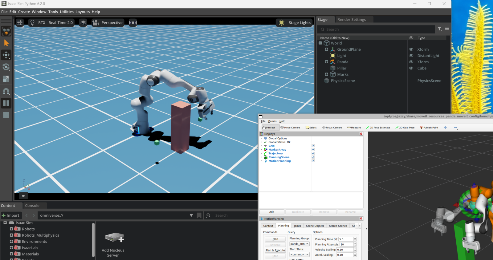

# MoveIt 실습 — Isaac Sim의 Panda를 MoveIt으로 움직이기

기존 라인 데모(`factory_line_demo.py`)는 **RAPID 방식**이다. 사람이 경로와 경유점을 적는다.
이 폴더는 같은 Isaac Sim 위에서 **MoveIt 방식**을 직접 돌려 본다. 사람은 목표만 주고, 경로는 MoveIt이 계산한다.



## 검증 결과 (2026-11-17, 이 PC)

| 항목 | 결과 |
| --- | --- |
| `send_trajectory.py` (MoveIt 없이 액션만) | 궤적 2개 성공, 남은 오차 0.0137 rad |
| 예제 1 관절 목표 | PASS |
| 예제 2 TCP 목표, OMPL·LIN·PTP | PASS |
| 예제 3 기둥 회피 | PASS (4회 실행, 궤적 점 수가 매번 다름) |
| 예제 3 `--no-scene` | 의도대로 `CONTROL_FAILED` (팔이 기둥에 걸림) |
| 예제 4 LIN 차단·경유점·OMPL | PASS (기둥을 뚫는 LIN은 계획 단계에서 거부) |
| GUI | Isaac Sim 창과 RViz 창을 같이 띄워 화면 확인 |

## 구성

```
 WSL Ubuntu 24.04 (ROS 2 Jazzy)                         Windows (Isaac Sim 6.2)
 ┌────────────────────────────────────────┐            ┌──────────────────────────────────┐
 │ examples/ex*.py  ──/move_action──▶      │            │ isaac_panda_sim.py  (/isaac_panda)│
 │                   move_group            │ Follow     │  궤적 보간 → Panda 관절 구동기     │
 │   IK(KDL)·OMPL·Pilz·충돌 검사·시간 붙이기 │ JointTraj. │  기둥(충돌체)·목표 표시            │
 │                   │ ────────────────────┼──액션────▶ │                                  │
 │ RViz MotionPlanning ◀── /joint_states ──┼────────────┤  /joint_states, /clock 발행        │
 └────────────────────────────────────────┘            └──────────────────────────────────┘
```

| 역할 | 어디서 | RAPID 대응 |
| --- | --- | --- |
| 목표 지정 (`ex*.py`, RViz) | WSL | RAPID 프로그램 (`MoveJ p10, ...`) |
| `move_group` 경로 계획 | WSL | 컨트롤러 안의 경로 계획기 |
| `isaac_panda_sim.py` 궤적 실행 | Windows | 서보 드라이브 + 모터 |
| `lab_common.py` 공용 숫자 | 둘 다 | 셀 도면, tooldata |

두 OS가 같은 PC에서 ROS 2(FastDDS)로 직접 통신한다. 2026-11-17 이 PC에서 Windows ↔ WSL 양방향 송수신을 확인했다 (WSL 기본 NAT 네트워크, 별도 설정 없음).

## 파일

| 파일 | 실행 위치 | 내용 |
| --- | --- | --- |
| `lab_common.py` | 둘 다 | 관절 이름, ready 자세, TCP 길이, 기둥·목표 좌표 |
| `isaac_panda_sim.py` | Windows | Isaac Sim 장면과 FollowJointTrajectory 액션 서버 |
| `send_trajectory.py` | Windows | MoveIt 없이 손으로 적은 궤적을 보내는 시험 클라이언트 |
| `wsl/moveit_isaac.launch.py` | WSL | `move_group` + RViz + TF |
| `wsl/examples/moveit_client.py` | WSL | 예제 공용 도우미 (`move_joints`, `move_tcp`, `add_box`) |
| `wsl/examples/ex1_named_pose.py` | WSL | 관절값 목표: SRDF 이름 자세와 직접 정의한 자세 (MoveAbsJ) |
| `wsl/examples/ex2_tcp_goal.py` | WSL | TCP 목표, OMPL·PTP·LIN 비교 (robtarget, MoveJ, MoveL) |
| `wsl/examples/ex3_obstacle.py` | WSL | 기둥 등록 → 자동 회피. `--no-scene`이면 기둥을 모르는 MoveIt |
| `wsl/examples/ex4_lin_vs_ompl.py` | WSL | 직선은 막히면 실패. 경유점 방식 vs 자동 탐색 |

## 준비 (한 번만)

WSL Ubuntu에 MoveIt 패키지를 설치한다. ROS 2 Jazzy desktop은 이미 설치되어 있다.

```bash
wsl -d Ubuntu-24.04 -- sudo apt-get install -y ros-jazzy-moveit ros-jazzy-moveit-resources-panda-moveit-config ros-jazzy-moveit-configs-utils
```

Isaac Sim 쪽은 추가 설치가 없다. 설치본에 들어 있는 ROS 2 Jazzy 라이브러리(`control_msgs` 포함)를 쓴다.
Panda 에셋은 첫 실행 때 에셋 서버에서 받는다 (이 PC에서 약 1분).

## 실행 순서

터미널 세 개를 쓴다. 1번을 먼저 띄운다. 2번 MoveIt은 `/clock`이 와야 시계가 돈다.

**1. Windows — Isaac Sim**

```bash
C:\isaacsim-6.2\python.bat moveit_lab\isaac_panda_sim.py
```

`[MOVEIT-LAB] /isaac_panda ready ...`가 찍히면 준비된 것이다. 창에 Panda, 빨간 기둥, 초록 표시 두 개가 보인다.

**2. WSL — MoveIt + RViz**

```bash
wsl -d Ubuntu-24.04
```

```bash
source /opt/ros/jazzy/setup.bash && ros2 launch /mnt/e/Github/IsaacSimProcess/moveit_lab/wsl/moveit_isaac.launch.py
```

`You can start planning now!`이 찍히고 RViz 창이 뜬다 (WSLg). RViz의 로봇 자세가 Isaac Sim과 같으면 연결된 것이다.

**3. WSL — 예제**

```bash
cd /mnt/e/Github/IsaacSimProcess/moveit_lab/wsl/examples && source /opt/ros/jazzy/setup.bash
```

```bash
python3 ex1_named_pose.py
```

단계마다 `결과 SUCCESS | 궤적 점 23개, 2.10 s` 같은 줄이 찍히고 마지막에 `EXAMPLE PASS`가 나온다.
Isaac Sim 창에서 팔이 움직인다. 예제 2·3·4도 같은 방법으로 실행한다.

### RViz에서 마우스로 해 보기

1. MotionPlanning 패널 > Planning 탭. Planning Group이 `panda_arm`인지 본다.
2. 손 끝의 파란 공·화살표(인터랙티브 마커)를 끌어 목표를 잡는다. 또는 Goal State에서 `ready`·`transport`를 고른다. `extended`는 Isaac Sim Franka의 4축 한계 밖이라 실행이 실패한다(예제 1 주석 참고).
3. **Plan**을 누르면 주황 궤적이 보인다. **Execute**를 누르면 Isaac Sim에서 실제로 움직인다.
4. Context 탭에서 Planning Library를 `pilz_industrial_motion_planner`로 바꾸고 `LIN`·`PTP`를 골라 같은 목표를 비교한다.
5. Scene Objects 탭에 `pillar`가 보이면 예제가 등록한 기둥이다.

### MoveIt 없이 액션만 시험

MoveIt이 마지막에 하는 일은 "시간이 붙은 관절 궤적"을 액션으로 보내는 것뿐이다. 그것을 손으로 해 본다.

```bash
C:\isaacsim-6.2\python.bat moveit_lab\send_trajectory.py
```

## 개념 정리 (RAPID 사용자 기준)

| MoveIt | 뜻 | RAPID·RobotStudio |
| --- | --- | --- |
| URDF | 링크·관절·충돌 모양 | 로봇 모델 |
| SRDF group | 같이 계획하는 관절 묶음 (`panda_arm` 7축) | 메카니컬 유닛 |
| SRDF group_state | 이름 붙인 관절 자세 (`ready`) | `CONST jointtarget` |
| Pose goal + IK(KDL) | TCP 목표를 관절값으로 푼다 | `robtarget` + 컨트롤러 IK |
| OMPL (RRTConnect) | 충돌 없는 경로를 무작위 탐색으로 찾는다 | 없음 (사람이 경유점을 찍는다) |
| Pilz PTP / LIN / CIRC | 정해진 모양의 경로 | `MoveJ` / `MoveL` / `MoveC` |
| Planning Scene | MoveIt이 아는 장애물 | 충돌 감지 대상, World Zone |
| `max_velocity_scaling_factor` | 속도 배율 | `VelSet` |
| 시간 붙이기 (TOTG) | 속도·가속 한계 안에서 각 점의 시각을 정한다 | 컨트롤러 가감속 |
| FollowJointTrajectory 액션 | 시각이 붙은 관절 궤적을 실행기로 보낸다 | 컨트롤러 내부 (밖으로 안 보임) |
| 결과 코드 `SUCCESS`, `PLANNING_FAILED`, `CONTROL_FAILED` | 계획 실패와 실행 실패를 구분한다 | 오류 로그 |

TCP. MoveIt의 Panda 모델에는 tooldata가 없다. `moveit_client.hand_pose()`가 TCP 목표를 손 링크(`panda_hand`) 목표로 바꾼다.
TCP는 손 링크 +Z로 `lab_common.TCP_Z` = 0.1034 m 나간 점이다. 방향 (180, 0, 0)이 공구가 바닥을 보는 자세다.

## 해 볼 것

1. 예제 1을 두 번 돌려 `궤적 점` 수가 바뀌는지 본다. OMPL은 매번 다른 경로를 찾는다.
2. RViz에서 예제 2를 보며 OMPL·PTP·LIN의 손끝 경로 모양(초록 선)을 비교한다.
3. 예제 3을 `--no-scene`으로 돌린다. 팔이 기둥에 걸리면 `CONTROL_FAILED`가 나온다. 계획은 성공해도 실행은 실패할 수 있다.
4. `lab_common.py`의 `OBSTACLE` 높이를 0.6 m로 바꾸고 두 쪽(Isaac Sim, 예제)을 다시 실행한다. 예제 4의 "기둥 위로 넘기" 경유점이 기둥에 걸려 실패한다. 경유점을 올리려 해도 공구가 아래를 보는 자세로는 z 0.65 m가 한계다. 반면 OMPL은 스스로 옆으로 돌아가는 길을 찾는다.
5. 예제 1의 `transport`를 `extended`로 바꿔 본다. 계획은 성공하는데 실행은 `CONTROL_FAILED`다. MoveIt 모델과 실제 로봇의 관절 한계가 다를 때 생기는 일이다.
6. `moveit_client.py`의 `self.velocity`를 1.0으로 올려 궤적 시간이 얼마나 줄어드는지 본다.

## 문제 해결

| 증상 | 원인과 조치 |
| --- | --- |
| 예제가 `/move_action을 못 찾았다`로 끝난다 | 2번 launch가 안 떠 있다 |
| RViz 로봇이 안 보이거나 시계가 0에 멈춰 있다 | Isaac Sim이 `/clock`·`/joint_states`를 안 보내고 있다. 1번이 재생 중인지 본다 |
| `ros2 topic list`에 `/joint_states`가 없다 | 두 쪽 RMW가 다르다. 둘 다 `rmw_fastrtps_cpp`여야 한다. Windows 방화벽이 Isaac Sim Python을 막는지 본다 |
| `start point deviates from current robot state` | 정지 오차가 허용값보다 크다. launch 파일의 `allowed_start_tolerance`(0.05 rad)를 확인한다 |
| `TIMED_OUT` (팔은 움직이는 중) | MoveIt 실행 시간 감시가 벽시계로 잰다. Isaac Sim이 느리면 넘는다. launch의 `allowed_execution_duration_scaling`(4.0)을 올린다 |
| LIN이 기둥을 뚫는데 계획이 SUCCESS | Pilz에 `ValidateSolution` 검사가 없을 때다. launch의 `pilz_checks`가 들어갔는지 본다 |
| `NO_IK_SOLUTION` | 그 TCP 자세로는 팔이 닿지 않는다. 높이·거리를 줄인다 |
| `START_STATE_IN_COLLISION` | 팔이 이미 장애물에 닿아 있다 (앞 동작이 부딪힌 경우). Isaac Sim을 정지 후 재생해 ready로 되돌린다 |
| `CONTROL_FAILED` | Isaac Sim 액션 서버가 abort를 돌려줬다. 1번 터미널의 `trajectory abort` 줄에 남은 오차가 찍힌다 |
| Isaac Sim을 정지 후 재생했더니 MoveIt이 이상하다 | `/clock`이 0으로 되돌아가 MoveIt·TF가 시간이 거꾸로 간 것으로 본다. 2번 launch도 다시 띄운다 |

## 제한

- 손가락(그리퍼)은 움직이지 않는다. MoveIt 설정의 컨트롤러가 팔 하나뿐이다 (`moveit_controllers.yaml`).
- 실제 Panda 드라이버는 ros2_control(`franka_ros2`)을 쓴다. 이 실습은 그 자리를 Python 액션 서버로 대신했다. 구조(MoveIt → FollowJointTrajectory)는 같다.
- MoveIt 공식 Isaac 연동(`ros2_control_hardware_type:=isaac`)은 `topic_based_ros2_control` 패키지가 필요한데 Jazzy apt에 없어서 쓰지 않았다 (2026-11-17 확인).
- 헤드리스 실행에서 Isaac Sim은 실시간의 약 0.4배로 돈다. MoveIt이 `use_sim_time`으로 같은 시계를 쓰므로 동작에는 문제가 없다.
